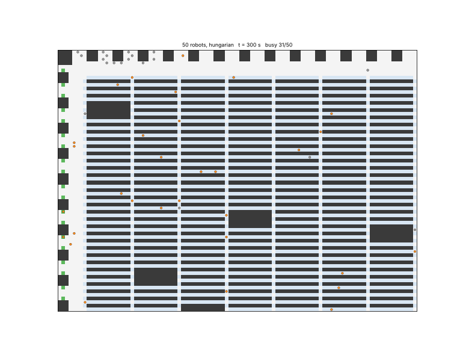
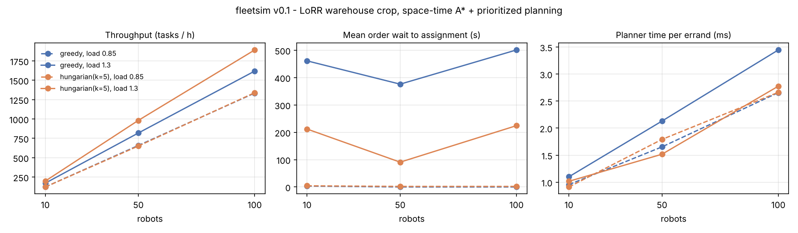
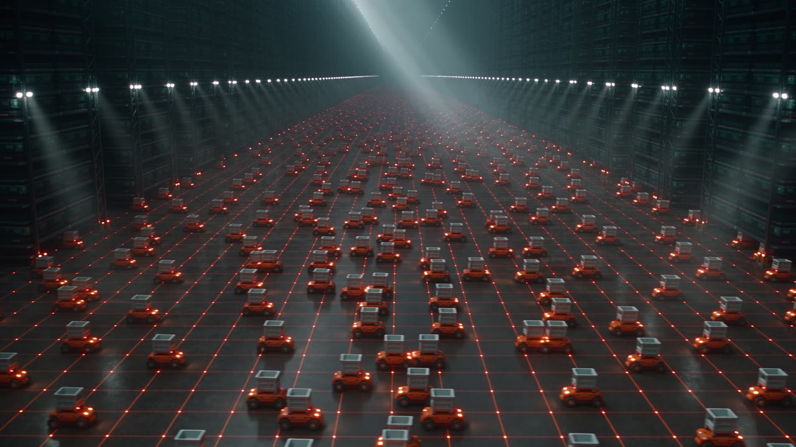

# fleetsim

[](https://github.com/zakcination/fleetsim/actions/workflows/ci.yml)
[](LICENSE)
[](https://zakcination.github.io/fleetsim/live.html)
[](CONTRIBUTING.md)

**Amazon-style fulfillment fleet: task allocation + MAPF + throughput analytics.** Open source, MIT.

**▶ [Live 3D simulator](https://zakcination.github.io/fleetsim/live.html)**: steer robots, demand, stations, dispatch policy and planner with sliders · **📖 [Field guide](https://zakcination.github.io/fleetsim/guide.html)**: the concepts, with in-browser demos · **🎬 [Teaser](docs/media/teaser.mp4)**

`fleetsim` simulates a goods-to-person warehouse. Drive units fetch storage pods, bring them to pick stations and put them back. The project is built in layers. v0.1 is the foundation: a grid world from a real benchmark map, a collision-free multi-robot planner, two task-allocation policies, and tick-level analytics. Later layers add ROS 2 nodes, Gazebo/Isaac visualisation, a perception pick station and learned policies (see [Roadmap](#roadmap)).



*50 robots, Hungarian allocation, offered load 1.0. Orange = on an order, grey = idle or heading home, green = pick stations, light blue = pod slots, dark = shelving.*

## What v0.1 does

| Layer | Implementation | Code |
|---|---|---|
| Warehouse map | [League of Robot Runners](https://github.com/MAPF-Competition/Start-Kit) 2026 `warehouse_long_corridor_large.map`, cropped to a 72 x 99 fulfilment cell: 4,109 drivable cells, **2,920 pod slots** (`S`), **19 pick stations** (`E`, left wall) | [`grid.py`](src/fleetsim/grid.py) |
| Orders | Poisson stream; each order = *fetch pod p -> station s -> return p*, with p and s uniform | [`orders.py`](src/fleetsim/orders.py) |
| Motion planning | Space-time A* with prioritized planning over a reservation table (vertex + edge/swap conflicts + parked robots). One search per errand: robot -> pod (lift 2 s) -> station (pick 10 s) -> pod (drop 2 s) -> home | [`planner.py`](src/fleetsim/planner.py) |
| Collision check | Independent checker over logged trajectories: vertex, swap, teleport, obstacle | [`checker.py`](src/fleetsim/checker.py) |
| Task allocation | (a) greedy: oldest order takes the nearest free robot, every tick; (b) Hungarian: `scipy.optimize.linear_sum_assignment` on travel-time costs, re-solved every k = 5 ticks; (c) nearest-pair greedy (added after v0.1 benchmarks). New policies plug in with `@register_allocator` | [`allocation.py`](src/fleetsim/allocation.py) |
| Analytics | Every robot x tick logged to SQLite + Parquet; KPIs; matplotlib chart; SQL notebook | [`analytics.py`](src/fleetsim/analytics.py), [`notebooks/analytics.ipynb`](notebooks/analytics.ipynb) |

## Quickstart

```bash
pip install -e ".[dev]"
```

```bash
pytest
```

```bash
fleetsim run --n 50 --allocator hungarian --load 1.3 --db results/fleetsim.db
```

```bash
fleetsim bench --out results
```

`fleetsim bench` runs the full table below (12 simulated hours plus warm-up, about 1-2 minutes) and writes `results/summary.csv`, `results/benchmark.png`, `results/fleetsim.db` and `results/parquet/`. `fleetsim gif` re-renders the animation.

A devcontainer based on `ros:jazzy` is included for the ROS 2 layer. ROS 2 Jazzy ships Python 3.12, so the container runs 3.12. CI tests 3.11 and 3.12.

## Results

Setup: 1 tick = 1 s, 1 measured hour after a 10-minute warm-up, seed 0. **Offered load** is the order rate as a fraction of the fleet's free-flow capacity, i.e. `N / (mean uncongested errand time)`. At **0.85** the fleet keeps up. At **1.3** orders arrive faster than the fleet can serve them, a backlog builds up, and the allocator has a real choice of which order to take next.

| Robots | Allocator | Load | Orders/h offered | **Tasks/h done** | Utilization | Travel-wait | Congestion delay / task | Order wait (censored) | Backlog at end | Planner ms/errand (mean / p95) | Collisions |
|---:|---|---:|---:|---:|---:|---:|---:|---:|---:|---:|---:|
| 10 | greedy | 0.85 | 131 | **122** | 72.7% | 0.1% | 0.7 s | 3 s | 2 | 1.0 / 1.8 | 0 |
| 10 | Hungarian | 0.85 | 131 | **122** | 71.2% | 0.1% | 0.4 s | 4 s | 2 | 0.9 / 1.4 | 0 |
| 50 | greedy | 0.85 | 655 | **658** | 72.3% | 0.8% | 3.0 s | 0 s | 0 | 1.7 / 5.1 | 0 |
| 50 | Hungarian | 0.85 | 655 | **651** | 72.3% | 0.9% | 3.3 s | 2 s | 0 | 1.6 / 4.6 | 0 |
| 100 | greedy | 0.85 | 1,322 | **1,335** | 70.7% | 2.1% | 7.3 s | 0 s | 0 | 2.7 / 7.1 | 0 |
| 100 | Hungarian | 0.85 | 1,322 | **1,340** | 70.4% | 2.0% | 7.0 s | 2 s | 2 | 2.5 / 7.9 | 0 |
| 10 | greedy | 1.3 | 200 | **171** | 100% | 0.1% | 0.7 s | 461 s | 46 | 1.0 / 1.6 | 0 |
| 10 | Hungarian | 1.3 | 200 | **198** | 98.9% | 0.2% | 0.7 s | 212 s | 17 | 0.9 / 1.4 | 0 |
| 50 | greedy | 1.3 | 1,002 | **819** | 100% | 0.9% | 4.1 s | 376 s | 219 | 2.1 / 5.7 | 0 |
| 50 | Hungarian | 1.3 | 1,002 | **982** | 98.9% | 1.3% | 3.8 s | 91 s | 55 | 1.5 / 4.6 | 0 |
| 100 | greedy | 1.3 | 2,022 | **1,619** | 100% | 2.2% | 9.5 s | 501 s | 524 | 3.4 / 10.6 | 0 |
| 100 | Hungarian | 1.3 | 2,022 | **1,892** | 99.0% | 2.9% | 8.8 s | 224 s | 232 | 2.8 / 7.8 | 0 |



**Metric definitions.** *Tasks/h*: pods returned to their slot within the measured hour. *Utilization*: share of robot-seconds spent on an order (to pod, lift, to station, pick, return, drop). *Travel-wait*: share of travelling robot-seconds in which the robot holds position to yield to another robot or wait for a busy station. *Congestion delay*: actual errand duration minus the free-flow shortest-path duration. *Order wait*: order creation to robot assignment; orders still unassigned at the end count with the wait so far, so an allocator can't look good by skipping hard orders. *Planner ms*: wall-clock time of one full-errand space-time A* call in pure Python.

### What the numbers say, and what they don't

* **Zero collisions in all 12 runs** (2.7 M robot-ticks, plus 12 more runs in the seed check), confirmed by the independent checker. This holds by construction: every robot always owns a conflict-free plan, and a failed search keeps the old plan. The planner tests check it as well (`tests/test_planner.py`, `tests/test_sim.py`).
* **Hungarian assignment adds +16-20% throughput when there is a backlog** (171->198, 819->982, 1,619->1,892 tasks/h) and halves the backlog. The gain holds across seeds:

  | Load 1.3, tasks/h (greedy -> Hungarian) | seed 0 | seed 1 | seed 2 |
  |---|---|---|---|
  | 10 robots | 171 -> 198 (+16%) | 171 -> 194 (+13%) | 166 -> 197 (+19%) |
  | 50 robots | 819 -> 982 (+20%) | 826 -> 989 (+20%) | 837 -> 982 (+17%) |
  | 100 robots | 1,619 -> 1,892 (+17%) | 1,613 -> 1,887 (+17%) | 1,637 -> 1,908 (+17%) |

   At load 0.85 the two policies are the same within noise: with 0-1 pending orders there is nothing to optimise. Hungarian also adds about 2 s of order latency because it batches every k = 5 ticks.
* **The main counterpoint:** much of the Hungarian gain may come from *which order is served* rather than from optimal matching. Greedy here is FIFO (the oldest order picks its robot). Hungarian chooses among the oldest `2 x free robots` orders and naturally takes the ones whose pods are close to free robots, which acts like shortest-job-first. Its worst-case wait is therefore sometimes *worse* (N=10: 1,202 s vs 877 s). A greedy "nearest order for each free robot" baseline would probably close part of the gap. That's a v0.2 experiment.
* **This map is not congestion-bound at 100 robots.** Density is 2.4% of drivable cells, travel-wait stays at 3% or below, and the congestion delay of 7-10 s per ~190 s errand grows with N but stays small, so throughput scales almost linearly. Waits concentrate in the left-wall corridor in front of the pick stations (heatmap in the notebook). Real Amazon floors run much denser, so stress tests at 200-400 robots on a tighter crop are next.
* **Load 1.3 is an unstable queue** (λ > μ), so its order-wait figures grow with the run length. Read them as a comparison between the two allocators, not as steady-state values.
* Planner cost grows with fleet size (1.0 -> 3.4 ms per errand, p95 ≤ 11 ms, worst case 158 ms) and stays far below the 1 s tick in pure Python.

### Analytics stack

Each run writes four tables to SQLite (`results/fleetsim.db`) and Parquet (`results/parquet/<table>/<run_id>.parquet`):

| Table | Grain | Columns |
|---|---|---|
| `runs` | simulation | config, offered rate, wall time |
| `ticks` | robot x second | `tick, robot, row, col, state, moved, waiting, order_id` |
| `orders` | order | `created, assigned, picked, at_station, serviced, completed, free_flow` |
| `plans` | planner call | `tick, robot, ms, ok, expansions, n_pending` |

[`notebooks/analytics.ipynb`](notebooks/analytics.ipynb) computes every KPI above in plain SQL (CTEs, joins, conditional aggregates). It also builds a censored order-wait table, a congestion heatmap, planner runtime and station utilisation. The `.db` file (~250 MB) is git-ignored. Regenerate it with `fleetsim bench`.

## Explore and contribute

[](docs/media/teaser.mp4)

| If you want to… | Go to |
|---|---|
| Play with a fleet in the browser | [`web/live.html`](web/live.html) (hosted on [GitHub Pages](https://zakcination.github.io/fleetsim/)) |
| Learn the concepts step by step | [`web/guide.html`](web/guide.html) |
| Add a dispatch policy, a map or a query | [`docs/EXTENDING.md`](docs/EXTENDING.md) |
| Pick a research or engineering task | [`docs/ROADMAP.md`](docs/ROADMAP.md): MAPF, warehouse ops, ROS 2 twin, perception, simulation method, web |
| Send a pull request | [`CONTRIBUTING.md`](CONTRIBUTING.md) |
| Cite fleetsim | [`CITATION.cff`](CITATION.cff) |

The repo ships a `ros:jazzy` devcontainer (`.devcontainer/`). CI runs the test suite, including the zero-collision simulation check, on Python 3.11 and 3.12.

## Design notes

* **Pods and stations.** LoRR marks `S` (service point, traversable) for pick-ups and `E` (emitter, traversable) for deliveries. fleetsim treats each `S` cell as one pod's storage slot and each left-wall `E` as a pick station. Pods are not simulated as physical obstacles while carried. Like LoRR, the robot visits the slot, which is the standard abstraction in lifelong-MAPF benchmarks.
* **Prioritized planning, lifelong.** When an order is assigned, the robot plans its whole errand against everyone else's reservations, i.e. priority = assignment order. Robots park permanently only on a dedicated home cell. Home cells are chosen so that blocking all of them keeps the free space connected, which means every errand stays feasible. Intermediate goals must stay free for the whole lift/pick/drop dwell. A* uses true BFS distances (LRU-cached) and a lower bound on the earliest feasible arrival time as its heuristic.
* **Known limitations.** Priority planning is incomplete: 0-2% of errand plans fail and are retried on a later tick. There are no rotations, acceleration or execution delays yet, and a single map crop is used.

## Roadmap

**Next: port the planner to C++ / ROS 2.**

1. C++17 planner core (space-time A* + reservation table) behind `pybind11`; target 10-100x faster per errand, then rolling-horizon PBS / windowed replanning.
2. ROS 2 Jazzy nodes: `fleet_manager` (allocation), `planner_server` (action server), `drive_unit` x N; Gazebo/Isaac visualisation using the devcontainer.
3. Perception pick station: camera + item detection, stochastic pick times.
4. Learned policies: RL / GNN dispatching benchmarked against the Hungarian baseline, plus the LoRR execution-delay model.
5. Stronger baselines: nearest-order greedy, aging-penalised Hungarian, multiple seeds with confidence intervals in CI.

## AI-assisted development log

FAR lists building tools with AI coding agents as a plus, so here is what was agent-assisted:

| Part | Who |
|---|---|
| Project brief, scope, metric choices, review | Human (author) |
| Map loader, planner, checker, allocation, simulation, analytics, CLI, tests, notebook, chart/GIF, README draft | Claude Code (cloud agent), from the brief, in one session |
| LICENSE, CI workflow, devcontainer, contributor docs, web pages, extension API | Claude Code (cloud agent) |
| Hero art, concept renders, teaser and loop videos (`docs/media/`) | Generated with Higgsfield (GPT Image 2.6, Seedance 2.5) from agent-written prompts |
| Interpretation of results and counterpoints above | Agent draft, to be checked by the author |

Every number in this README comes from `fleetsim bench` (seed 0) and the notebook. None were typed in by hand.

## Credits

Map: League of Robot Runners Start-Kit (MIT), see [`src/fleetsim/maps/README.md`](src/fleetsim/maps/README.md). The images and videos in `docs/media/` are AI-generated illustrations made with Higgsfield. They are not simulator output; the simulator's own visuals are `docs/fleet.gif` and the live demo. Problem framing follows lifelong MAPF (Li et al., *Lifelong MAPF in Large-Scale Warehouses*, AAAI 2021) and prioritized planning with space-time A* (Silver, 2005).

## License

MIT, see [LICENSE](LICENSE).
