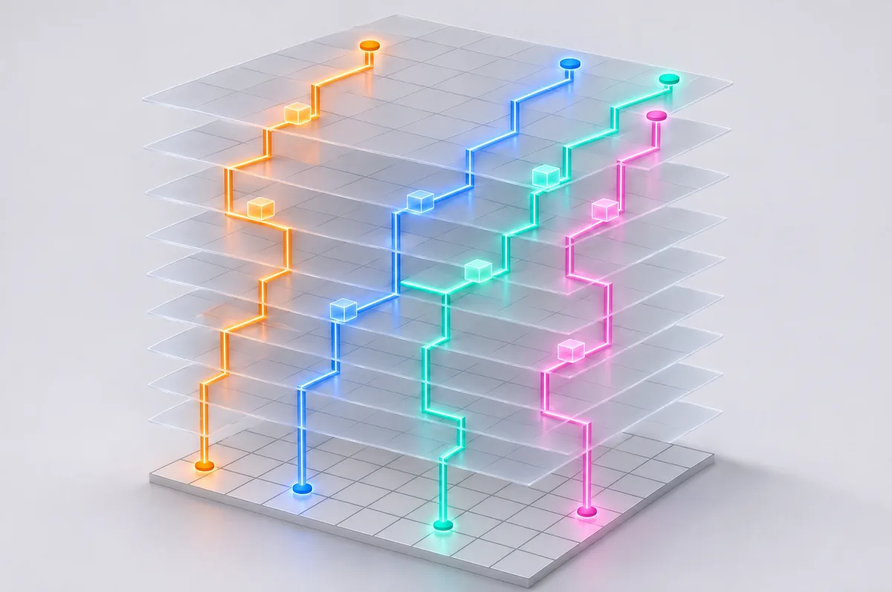
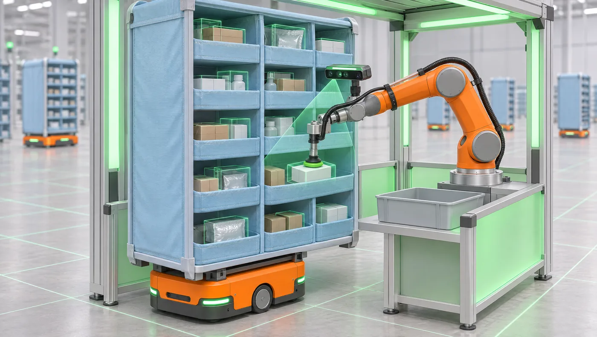

# fleetsim roadmap

v0.1 is a foundation: one map, prioritized space-time A*, three dispatch policies, tick-level analytics, a live web demo. Everything below is open for contributions. Pick a track, open an issue saying you're on it, and send a small PR.

**Difficulty:** 🟢 good first issue (an afternoon) · 🟡 a weekend · 🔴 research-grade (thesis chapter)

## Track A · Planning (MAPF)

| | Item | Why it matters |
|---|---|---|
| 🟢 | Property-based tests for `space_time_astar` (random grids and reservations, assert no conflicts) | Hardens the zero-collision guarantee |
| 🟢 | Plot plan-failure rate vs. fleet size in the notebook | Makes the incompleteness of prioritized planning visible |
| 🟡 | Random-restart priorities: on failure, retry the batch in a shuffled order | Cheap fix for incompleteness |
| 🟡 | Windowed replanning (RHCR-style, plan only the next *w* steps, replan every *h*) | The standard lifelong-warehouse approach (Li et al., AAAI 2021) |
| 🔴 | Priority-Based Search (Ma et al., AAAI 2019) | Searches over priority orders; near-optimal |
| 🔴 | PIBT / LaCAM (Okumura) | Scales to thousands of robots |
| 🔴 | Execution delays (LoRR 2026 `delayConfig`) plus robust replanning | Real robots are late; measure throughput under disturbance |
| 🟡 | Turn time: rotation as its own one-tick action (the LoRR model: forward, rotate, wait), so a robot's state is (cell, heading, time); behind a switch, with a trial on how much throughput turns cost and whether policy rankings change | Today turns are free; real drive units stop, rotate and accelerate |
| 🔴 | Acceleration and deceleration limits on top of turn time | Closer to real drive-unit kinematics |
| 🟡 | Safety zones around technicians (robots keep one or two cells of distance, as real sites do) on top of the booked corridors of v0.2 ([T4](trials/T4-technician-corridors.md)) | People don't walk on schedule; a zone is more robust than a timetable |
| 🟢 | Chargers: pick the charger with the earliest free slot, not only the nearest (found in trial T2) | Removes an artificial charging bottleneck |

## Track B · Dispatch and warehouse operations

| | Item | Why it matters |
|---|---|---|
| 🟢 | Aging-penalised Hungarian: cost = travel − λ·age | Trades throughput for fairness; plot the frontier over λ |
| 🟢 | Report p95/p99 order wait in `summarize` and the bench table | Tail latency is what customers feel |
| 🟡 | Class-based storage: return popular pods to slots near stations | Often a bigger lever than path planning |
| 🟡 | Station queues with explicit queue cells instead of in-aisle waiting | Removes the congestion hotspot in front of the stations |
| 🔴 | Joint task assignment + path finding (CBS-TA, Hönig et al. 2018) | Optimal on small instances; a gold standard to compare against |
| 🔴 | Learned dispatch (RL / GNN), compared against Hungarian and nearest-pair | Honest test of whether learning beats tuned heuristics |

## Track C · ROS 2 / digital twin

| | Item | Why it matters |
|---|---|---|
| 🟡 | `fleet_manager` ROS 2 node publishing assignments; `drive_unit` nodes consuming paths | The architecture a real fleet uses |
| 🟡 | Planner as a ROS 2 action server (C++ core via pybind11 first) | 10–100× faster planning |
| 🔴 | Gazebo or Isaac Sim scene generated from the LoRR map | Physics, sensors and timing a grid sim can't show |

*Concept render (AI-generated), not current functionality.*

## Track D · Perception pick station

| | Item | Why it matters |
|---|---|---|
| 🟡 | Stochastic pick times from a distribution (e.g. log-normal per SKU class) | Stations stop being deterministic |
| 🔴 | Camera + item detection model at the station; pick success affects order completion | Connects robotics perception to fleet KPIs |

## Track E · Analytics and simulation method

| | Item | Why it matters |
|---|---|---|
| 🟢 | DuckDB example querying `results/parquet/` directly | Columnar analytics without SQLite |
| 🟡 | Replications + confidence intervals in `fleetsim bench` (common random numbers across policies) | Turns single-seed results into defensible ones |
| 🟡 | Welch's method for warm-up detection | Replaces the fixed 10-minute warm-up |
| 🔴 | Validate against an analytic semi-open queueing model (Lamballais, Roy & De Koster, 2017) | Simulation meets queueing theory |

## Track F · Web demo

| | Item | Why it matters |
|---|---|---|
| 🟢 | Congestion heatmap overlay in `web/live.html` | Shows where robots wait |
| 🟢 | "Share this config" link that encodes the sliders in `#hash` | Lets people send each other experiments |
| 🟡 | Replay a Python Parquet log in the 3D view | One viewer for both engines |

## Track G · Incidents and resilience

Design and rules: [INCIDENTS.md](INCIDENTS.md). An incident is a scenario with a response policy and a trial, never a bare event.

| | Item | Why it matters |
|---|---|---|
| 🟡 | Incident list in `SimConfig`, twin-run analysis (same seed, no incident), recovery KPIs | The shared mechanism every item below needs |
| 🟢 | `power`: chargers offline for a window; trial on idle top-up as ride-through reserve | Ties battery policy to an outage you can measure |
| 🟢 | `stop`: fleet-wide hold (control outage, e-stop); restart all at once vs. in waves | Recovery after a restart is where queues blow up |
| 🟡 | `zone`: close a rectangle of cells (spill, person on the floor); hold vs. evacuate | Same machinery as a stopped robot, at area scale |
| 🟡 | `telemetry`: observed health differs from true health (bias, noise, stuck value, gaps) | Tests whether condition-based maintenance survives bad data |
| 🔴 | `collision`: robots that run late can touch; needs the execution-delay item in Track A | The only incident that breaks the zero-collision guarantee, so it comes last |

## Related work worth connecting to

- League of Robot Runners: competition, maps and evaluation harness. <https://github.com/MAPF-Competition/Start-Kit>
- RAWSim-O: research simulator for robotic mobile fulfillment systems (Merschformann et al.)
- Merschformann, Lamballais, de Koster & Suhl (2019). *Decision rules for robotic mobile fulfillment systems.* Operations Research Perspectives.
- Azadeh, De Koster & Roy (2019). *Robotized and Automated Warehouse Systems: Review and Recent Developments.* Transportation Science.
