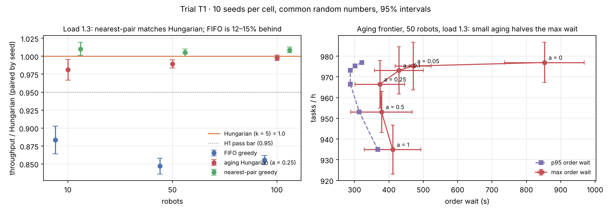

# T1 · Is Hungarian's gain optimal matching or queue discipline?

**Status:** pre-registered on 2026-11-09, before any T1 run. Results are appended below the line and the protocol is not edited afterwards.

## Background

The v0.1 benchmark (one seed) showed Hungarian assignment completing 16–20% more tasks per hour than first-come-first-served greedy at offered load 1.3. Hungarian differs from FIFO greedy in two ways at once:

1. it solves the assignment optimally (minimum total travel), and
2. it chooses *which* orders to serve from a window of the oldest `2 × free robots`, favouring orders whose pods are near free robots.

Nearest-pair greedy keeps (2) and drops (1): same order window, no batching delay, but a greedy rather than optimal matching. Aging Hungarian keeps (1) and weakens (2) by subtracting `λ × age` from each order's cost.

## Hypotheses

- **H1.** At load 1.3, nearest-pair greedy reaches at least 95% of Hungarian's throughput at every fleet size. If true, most of the gain comes from queue discipline, not optimal matching.
- **H2.** Increasing the aging weight λ lowers the p95 order wait and lowers throughput monotonically, forming a fairness–throughput frontier.
- **H3 (control).** At load 0.85, all policies are within 2% of each other on throughput.

## Protocol

| Factor | Levels |
|---|---|
| Policy | `greedy` (FIFO), `nearest`, `hungarian` (k = 5), `hungarian_aging` (k = 5) |
| Fleet size N | 10, 50, 100 |
| Offered load | 0.85, 1.3 |
| Aging weight λ (`hungarian_aging` only) | 0.25 in the main grid; frontier at N = 50, load 1.3: 0, 0.05, 0.1, 0.25, 0.5, 1.0 |
| Replications | 10 seeds (0–9), common random numbers: the same seed gives every policy the same order stream and robot homes |

Each run: 600 s warm-up, then 3,600 s measured. Metrics: tasks/h, mean / p95 / max order wait (censored), utilization, collisions. Policies are compared with **paired** differences by seed; intervals are 95% t-intervals over the 10 seeds.

**Pass bars.** H1 holds if the lower 95% bound of `nearest / hungarian` throughput is ≥ 0.95 at load 1.3 for all N. H2 holds if p95 wait and throughput both decrease from λ = 0 to λ = 1.0 with non-overlapping intervals at the ends. H3 holds if every pairwise throughput difference at load 0.85 has a 95% interval inside ±2%.

Reproduce:

```bash
fleetsim bench --allocators greedy nearest hungarian hungarian_aging --robots 10 50 100 --loads 0.85 1.3 --replications 10 --no-db --no-parquet --out results/T1
```

```bash
fleetsim bench --allocators hungarian_aging --aging 0 0.05 0.1 0.25 0.5 1.0 --robots 50 --loads 1.3 --replications 10 --no-db --no-parquet --out results/T1-frontier
```

---

## Results (run 2026-11-09, commit after `b24423a`)

300 runs (240 in the main grid, 60 in the frontier), **0 collisions**. Raw data: [`results/T1/runs.csv`](../../results/T1/runs.csv), [`results/T1/paired.csv`](../../results/T1/paired.csv), [`results/T1-frontier/runs.csv`](../../results/T1-frontier/runs.csv). Chart: `python scripts/plot_t1.py`.



**Throughput relative to Hungarian (k = 5), paired by seed, mean [95% interval]:**

| Robots | Load | FIFO greedy | Nearest-pair | Aging Hungarian (a = 0.25) |
|---:|---:|---|---|---|
| 10 | 0.85 | 0.993 [0.984, 1.003] | 1.001 [0.998, 1.004] | 1.000 [0.997, 1.003] |
| 50 | 0.85 | 1.001 [0.998, 1.004] | 1.001 [0.998, 1.004] | 1.000 [1.000, 1.000] |
| 100 | 0.85 | 1.000 [0.998, 1.002] | 0.999 [0.997, 1.002] | 1.000 [1.000, 1.000] |
| 10 | 1.3 | 0.883 [0.864, 0.903] | **1.010 [1.001, 1.020]** | 0.981 [0.967, 0.996] |
| 50 | 1.3 | 0.847 [0.836, 0.858] | **1.005 [1.000, 1.010]** | 0.989 [0.983, 0.995] |
| 100 | 1.3 | 0.855 [0.849, 0.862] | **1.009 [1.005, 1.013]** | 0.998 [0.994, 1.002] |

**Aging frontier (50 robots, load 1.3), mean ± 95% half-width:**

| Aging a | Tasks/h | p95 wait (s) | Max wait (s) |
|---:|---:|---:|---:|
| 0 (plain Hungarian) | 976.9 ± 9.7 | 321 ± 65 | 853 |
| 0.05 | 975.2 ± 11.5 | 301 ± 65 | 470 |
| 0.10 | 973.1 ± 11.5 | 288 ± 70 | 429 |
| 0.25 | 966.4 ± 11.5 | 288 ± 74 | 374 |
| 0.50 | 953.1 ± 10.0 | 314 ± 79 | 379 |
| 1.00 | 934.9 ± 11.8 | 368 ± 84 | 411 |

### Verdicts against the pre-registered bars

- **H1: holds.** Nearest-pair's lower bound is ≥ 1.000 at every fleet size at load 1.3, well above the 0.95 bar. Nearest-pair is slightly *ahead* of Hungarian, most likely because it matches every second while Hungarian waits up to 5 s for its batch. Hungarian's 12–15% advantage over FIFO comes from serving near orders first, not from optimal matching.
- **H2: fails as stated.** Throughput falls monotonically with a (977 → 935 tasks/h, end intervals do not overlap). p95 wait does **not**: it is U-shaped (321 → 288 → 368 s). What aging does buy is a much lower *maximum* wait: a = 0.05 already cuts it from 853 s to 470 s for 0.2% throughput. Too much aging (a ≥ 0.5) sends robots far for old orders and hurts both.
- **H3: holds.** Every pairwise throughput ratio at load 0.85 has its 95% interval inside ±2%. Hungarian adds ~4 s of p95 wait there through batching, with no throughput benefit.

### What this changes

1. For this warehouse, recommend **nearest-pair greedy** (or Hungarian with k = 1) plus a **small aging term** over batch Hungarian: the same throughput, no batching delay, and a bounded worst case.
2. The v0.1 README's "Hungarian +17%" is real, but the right attribution is queue discipline. The README now says so.
3. Follow-ups: aging added to nearest-pair; k = 1 Hungarian as a control; a denser map where matching quality might matter more.
