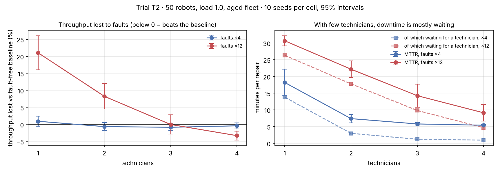

# T2 · How many technicians does a fleet need?

**Status:** pre-registered on 2026-11-09, before any T2 run. Results are appended below the line; the protocol is not edited afterwards.

**Disclosure.** Before writing this, one smoke run (50 robots, aged fleet, normal faults, 2 technicians, run-to-failure) showed a mean time to repair of 1,957 s, of which 1,695 s was waiting for a technician. That run shaped H1 and is not part of the trial data.

## Background

A failed robot stops where it stands, blocks the aisle, and waits for a technician. Repair capacity therefore behaves like the classic *machine-repair queue*: with too few technicians, most downtime is spent waiting, not repairing. This trial measures how much throughput each extra technician buys back. The plan's original T2 ("health-aware dispatch") overlapped with T3's maintenance policies, so T2 was redefined before any run.

The health model is a teaching model (rates in `src/fleetsim/health.py`), so the numbers are about this model, not a real fleet. What should transfer is the shape: queueing-dominated downtime and diminishing returns.

## Hypotheses

- **H1.** At frequent faults (×12) with 1 technician, more than half of mean time to repair is spent waiting for the technician.
- **H2.** At frequent faults, going from 1 to 2 technicians recovers at least 50% of the throughput lost to faults; going from 3 to 4 recovers less than 10%.
- **H3 (safety).** Every run is collision-free, including all fault and replanning events.

## Protocol

| Factor | Levels |
|---|---|
| Fault rate | 0 (baseline), 4 (normal), 12 (frequent) |
| Technicians | 1, 2, 3, 4 (baseline runs: 2; technicians are idle without faults) |
| Fixed | 50 robots, load 1.0, nearest-pair dispatch, batteries on with 4 chargers, aged fleet (initial wear U(0, 0.6)), run-to-failure maintenance |
| Replications | 10 seeds (0–9), common random numbers: same orders, homes, initial wear and per-tick fault draws across arms |

Each run: 600 s warm-up, then 3,600 s measured. **Throughput lost to faults** = 1 − tasks/h ÷ tasks/h of the fault-free run with the same seed. **Recovered share** going from c to c + 1 technicians = (loss(c) − loss(c + 1)) / loss(c), computed per seed and averaged, with a 95% t-interval.

**Pass bars.** H1: the lower 95% bound of waiting ÷ MTTR is above 0.5. H2: the mean recovered share 1→2 is ≥ 0.5 and the mean recovered share 3→4 is < 0.1. H3: zero collisions across all runs.

Reproduce:

```bash
fleetsim bench --robots 50 --loads 1.0 --allocators nearest --battery --initial-wear 0.6 --faults 4 12 --techs 1 2 3 4 --replications 10 --no-db --no-parquet --out results/T2
```

```bash
fleetsim bench --robots 50 --loads 1.0 --allocators nearest --battery --initial-wear 0.6 --faults 0 --techs 2 --replications 10 --no-db --no-parquet --out results/T2-baseline
```

---

## Results (run 2026-11-09, commit `c25c5d0`)

**Run log.** The first launch crashed at run 41 of 80: a robot failed on a cell booked as another robot's future parking spot, and the reservation table refused the double booking (no collision occurred). The bug was fixed in `c25c5d0` with a regression test, and **all runs were restarted from scratch** on the fixed code. Nothing from the crashed launch is used.

90 runs (10 baseline + 80), **0 collisions**. Raw data: [`results/T2/runs.csv`](../../results/T2/runs.csv), [`results/T2-baseline/runs.csv`](../../results/T2-baseline/runs.csv). Tables and chart: `python scripts/analyze_t2_t3.py T2`.



Fault-free baseline: 522.6 ± 11.1 tasks/h. Mean ± 95% half-width over 10 seeds:

| Faults | Technicians | Tasks/h | vs baseline (paired) | Availability | Failures | MTTR (s) | of which waiting (s) | Waiting share |
|---:|---:|---:|---|---:|---:|---:|---:|---:|
| ×4 | 1 | 517.7 ± 11.8 | 0.991 [0.976, 1.005] | 0.901 | 13.9 | 1,092 | 828 | 0.73 ± 0.09 |
| ×4 | 2 | 526.1 ± 15.4 | 1.006 [0.995, 1.018] | 0.964 | 13.5 | 443 | 178 | 0.38 ± 0.08 |
| ×4 | 3 | 527.1 ± 14.3 | 1.008 [0.998, 1.019] | 0.973 | 13.2 | 347 | 73 | 0.21 ± 0.03 |
| ×4 | 4 | 524.8 ± 12.8 | 1.004 [0.995, 1.013] | 0.974 | 14.0 | 324 | 56 | 0.17 ± 0.02 |
| ×12 | 1 | 412.1 ± 23.9 | 0.789 [0.739, 0.840] | 0.630 | 28.5 | 1,841 | 1,581 | 0.86 ± 0.01 |
| ×12 | 2 | 479.4 ± 21.7 | 0.917 [0.880, 0.955] | 0.728 | 32.4 | 1,331 | 1,068 | 0.80 ± 0.02 |
| ×12 | 3 | 522.8 ± 19.5 | 1.000 [0.972, 1.028] | 0.826 | 33.2 | 855 | 589 | 0.65 ± 0.11 |
| ×12 | 4 | 539.9 ± 14.8 | **1.033 [1.020, 1.046]** | 0.882 | 35.5 | 548 | 281 | 0.45 ± 0.13 |

### Verdicts against the pre-registered bars

- **H1: holds.** At faults ×12 with 1 technician, 86% of repair time is waiting for the technician (lower 95% bound 0.85). Even at normal faults, one technician means 73% waiting.
- **H2, first half: holds.** The second technician recovers 62% ± 15% of the lost throughput (+67 tasks/h); the bar was a mean of at least 50%.
- **H2, second half: not evaluable.** The bar compared the fourth technician's gain with the loss remaining at three technicians, but that loss is zero within noise (0.0% ± 2.8%). In absolute terms each technician adds less: +67, +43, +17 tasks/h.
- **H3: holds.** Zero collisions in all 90 runs, through 1,842 failures and their replanning.

### The result that should not happen, and why it did

With frequent faults and 4 technicians the fleet completed **3.3% more** than the fault-free baseline (ratio 1.033, interval [1.020, 1.046]). Faults cannot make a fleet faster, so the protocol was confounded.

Post-hoc diagnosis (exploratory, not pre-registered): the baseline is throttled by **charging**, not by anything this trial varies. Every robot starts with a 70–100% battery, so the whole fleet reaches the 25% threshold in the same quarter-hour, late in the 70-minute run. In the baseline, robots spend 29% of their time idle with a low battery, waiting for one of 4 chargers, and 303 orders are still waiting at the end. A robot that is broken down does not drain its battery, and a battery-pack repair returns it fully charged, so faults desynchronize the charging wave and partly offset their own cost. At normal faults (×4) the two effects cancel: every arm is within ±2.5% of the baseline.

Two more weaknesses the trial exposed in the model: robots only consider the **nearest** charger, and a 70-minute horizon measures a start-up transient of the battery cycle, not a steady state.

### What this changes

1. The waiting-time result (H1) stands. **Update after T2b:** the diminishing gains do not. With batteries off, each added technician keeps paying off at frequent faults (+93, +56, +69 tasks/h); the pattern here was the charging ceiling.
2. The size of the throughput loss is **not** trustworthy from this trial. [T2b](T2b-repair-capacity-no-battery.md) repeats it with batteries off, pre-registered before any run.
3. Backlog items: choose the charger with the earliest free slot; stagger initial charge or lengthen the horizon to several battery cycles; a charger-capacity trial of its own.
