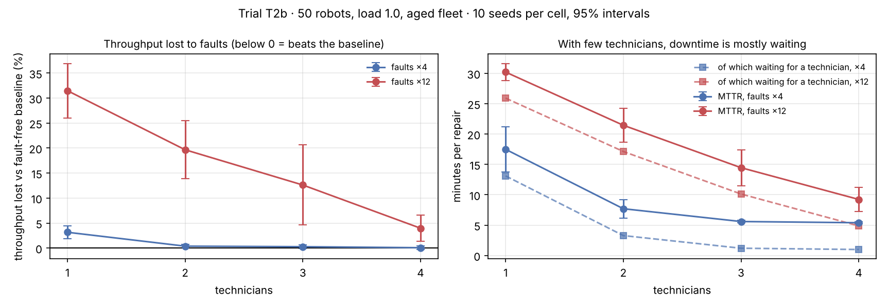

# T2b · Repair capacity without the charging confound

**Status:** pre-registered on 2026-11-09, before any T2b run. Results are appended below the line; the protocol is not edited afterwards.

**Disclosure.** This follow-up was designed after seeing [T2](T2-repair-capacity.md)'s results. T2 showed a waiting share of 0.86 of repair time (faults ×12, 1 technician) and a recovered share of 0.62 for the second technician, so H1 and H2 below are informed predictions, not blind ones. T2 also showed that its fault-free baseline was throttled by a synchronized battery-charging wave (29% of robot time idle with a low battery), which made faults look almost free. T2b removes batteries to isolate repair capacity.

## Hypotheses

- **H1.** At frequent faults (×12) with 1 technician, more than half of mean time to repair is spent waiting for the technician.
- **H2.** At frequent faults, going from 1 to 2 technicians recovers at least 50% of the throughput lost to faults; going from 3 to 4 recovers less than 10% of the loss that remains at 3.
- **H3.** With batteries off, every fault arm completes fewer tasks per hour than the fault-free baseline (paired by seed, upper 95% bound of the ratio below 1). In T2 this failed: the 4-technician arm beat the baseline.
- **H4 (safety).** Every run is collision-free.

## Protocol

Identical to T2 except **batteries off**: 50 robots, load 1.0, nearest-pair dispatch, aged fleet (initial wear U(0, 0.6)), run-to-failure maintenance, fault rate {4, 12} × technicians {1, 2, 3, 4}, plus a fault-free baseline; 10 seeds (0–9) with common random numbers; 600 s warm-up and 3,600 s measured. Metrics and the definition of "recovered share" are as in T2. If the loss at 3 technicians is not distinguishable from zero (95% interval includes 0), the second half of H2 is reported as "not evaluable" and the absolute gain in tasks/h is reported instead.

Reproduce:

```bash
fleetsim bench --robots 50 --loads 1.0 --allocators nearest --replications 10 --no-db --no-parquet --out results/T2b-baseline
```

```bash
fleetsim bench --robots 50 --loads 1.0 --allocators nearest --initial-wear 0.6 --faults 4 12 --techs 1 2 3 4 --replications 10 --no-db --no-parquet --out results/T2b
```

**Protocol correction, made before any T2b run.** The first version of this file ran the baseline with `--maintenance interval`, which would have sent robots for scheduled services and lowered the baseline. The baseline is now a plain run with the health layer off. With the same seed it has the same orders and robot homes, and without batteries or faults the health layer does not change how robots move.

---

## Results (run 2026-11-09, commit `c25c5d0`)

90 runs (10 baseline + 80), **0 collisions**. Raw data: [`results/T2b/runs.csv`](../../results/T2b/runs.csv), [`results/T2b-baseline/runs.csv`](../../results/T2b-baseline/runs.csv). Tables and chart: `python scripts/analyze_t2_t3.py T2b`.



Fault-free baseline: **793.7 ± 17.9 tasks/h** (with batteries on it was 522.6, which confirms that charging was the limit in T2). Mean ± 95% half-width over 10 seeds:

| Faults | Technicians | Tasks/h | vs baseline (paired) | Availability | Failures | MTTR (s) | of which waiting (s) | Waiting share |
|---:|---:|---:|---|---:|---:|---:|---:|---:|
| ×4 | 1 | 768.5 ± 16.4 | 0.968 [0.955, 0.982] | 0.882 | 18.8 | 1,049 | 786 | 0.72 ± 0.08 |
| ×4 | 2 | 790.7 ± 17.9 | 0.996 [0.993, 0.999] | 0.948 | 19.5 | 462 | 197 | 0.40 ± 0.08 |
| ×4 | 3 | 791.6 ± 18.4 | 0.997 [0.994, 1.001] | 0.964 | 19.0 | 336 | 72 | 0.21 ± 0.02 |
| ×4 | 4 | 793.2 ± 18.6 | 0.999 [0.996, 1.003] | 0.965 | 19.9 | 324 | 59 | 0.18 ± 0.02 |
| ×12 | 1 | 543.7 ± 43.7 | 0.685 [0.631, 0.740] | 0.595 | 35.1 | 1,813 | 1,555 | 0.86 ± 0.01 |
| ×12 | 2 | 636.4 ± 37.9 | 0.803 [0.745, 0.861] | 0.697 | 39.4 | 1,287 | 1,028 | 0.79 ± 0.03 |
| ×12 | 3 | 692.4 ± 58.6 | 0.874 [0.794, 0.954] | 0.779 | 44.0 | 868 | 608 | 0.68 ± 0.07 |
| ×12 | 4 | 761.7 ± 16.6 | 0.960 [0.934, 0.986] | 0.850 | 47.1 | 554 | 292 | 0.49 ± 0.09 |

Throughput gained per added technician at faults ×12: +93, +56, +69 tasks/h (recovered shares 0.37 ± 0.15, 0.42 ± 0.32, 0.67 ± 0.18). At faults ×4: +22, +1, +2 tasks/h (the second technician recovers 91% ± 9% of the loss).

### Verdicts against the pre-registered bars

- **H1: holds.** At faults ×12 with 1 technician, 86% of repair time is waiting (lower bound 0.85). The same as in T2.
- **H2: fails, both halves.** At faults ×12 the second technician recovers 37% of the loss, not the predicted 50% or more, and the fourth recovers 67% of what remained, not less than 10%. There are **no diminishing returns up to 4 technicians** at this fault rate. The pattern T2 seemed to show was the charging ceiling, not repair capacity.
- **H3: holds for 6 of 8 arms.** With batteries off no faulty fleet beats the baseline. For faults ×4 with 3 or 4 technicians the loss is 0.1–0.3% and the interval's upper bound just crosses 1 (1.001, 1.003), so the bar "upper bound below 1" is not met there.
- **H4: holds.** Zero collisions.

### Why (exploratory, not pre-registered)

Technicians are servers in a queue, and what matters is the **offered repair load**: failures per hour × technician time per job. A job takes about 265 s of repair plus roughly 80 s of walking, about 345 s in total.

- Faults ×4: about 19 failures/h × 345 s ≈ **1.8 technician-hours of work per hour**. One technician is overloaded; two keep up; a third and fourth add nothing.
- Faults ×12: about 35–47 failures/h × 345 s ≈ **3.4–4.5 technician-hours per hour**. Even four technicians are working flat out, so every added technician still pays off almost fully.

The number of failures also rises with technicians (35 → 47 per hour), because repaired robots go back to work and can fail again.

### What this changes

1. Size the repair crew from the offered repair load, as a call centre sizes agents: technicians needed ≈ failures/h × (walk + repair seconds) / 3,600, plus headroom. "Each technician buys back less" is only true once the crew exceeds that load.
2. T2's headline about diminishing returns is withdrawn; its waiting-time finding stands.
3. Two of this project's five trials so far had a hypothesis fail and one had a flawed design. All are reported.
