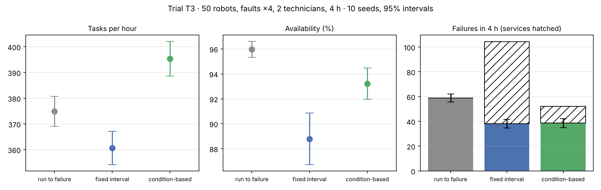

# T3 · Run to failure, fixed intervals, or condition-based maintenance?

**Status:** pre-registered on 2026-11-09, before any T3 run. Results are appended below the line; the protocol is not edited afterwards.

## Background

In fleetsim's health model, worn parts fail more often: the motor and lift fault hazards grow with wear cubed. A failed robot stops in the aisle and blocks traffic until repaired (5 min for a motor). A **service** instead takes the robot home after its current job, stops it there (no aisle blocked), and resets all wear in 2.5 min. Three policies:

- **Run to failure (`none`):** never service; repair what breaks.
- **Fixed interval (`interval`):** service each robot after 5,400 s of operation (clocks staggered at random).
- **Condition-based (`condition`):** service a robot when any part's wear reaches 0.5, using the telemetry the robot already reports.

The rates are a teaching model (`src/fleetsim/health.py`), so the result is about this model. What should transfer is whether acting on telemetry beats both extremes.

## Hypotheses

- **H1.** Condition-based maintenance completes more tasks per hour than run-to-failure (paired ratio, lower 95% bound > 1).
- **H2.** Condition-based maintenance completes more tasks per hour than fixed-interval maintenance (paired ratio, lower 95% bound > 1).
- **H3.** Condition-based maintenance has at least 30% fewer failures than run-to-failure (mean paired reduction ≥ 0.3).

## Protocol

| Factor | Levels |
|---|---|
| Maintenance policy | none, interval (5,400 s), condition (wear ≥ 0.5) |
| Fixed | 50 robots, load 1.0, nearest-pair dispatch, batteries on with 4 chargers, faults ×4 (normal), 2 technicians, aged fleet (initial wear U(0, 0.6)) |
| Horizon | 600 s warm-up, then 4 h measured (wear needs time to matter) |
| Replications | 10 seeds (0–9), common random numbers across policies |

Metrics: tasks/h, availability, failures, services, MTTR, blocked share. Policies are compared with paired ratios by seed and 95% t-intervals.

Reproduce:

```bash
fleetsim bench --robots 50 --loads 1.0 --allocators nearest --battery --initial-wear 0.6 --faults 4 --techs 2 --maintenance none interval condition --ticks 14400 --replications 10 --no-db --no-parquet --out results/T3
```

---

## Results (run 2026-11-09, commit `c25c5d0`)

30 runs of 4 simulated hours, **0 collisions**. Raw data: [`results/T3/runs.csv`](../../results/T3/runs.csv). Tables and chart: `python scripts/analyze_t2_t3.py T3`.



Mean ± 95% half-width over 10 seeds:

| Policy | Tasks/h | Availability | Failures in 4 h | Services in 4 h | MTTR (s) |
|---|---:|---:|---:|---:|---:|
| Run to failure | 374.9 ± 5.9 | 0.960 ± 0.006 | 58.9 ± 3.2 | 0 | 490 ± 76 |
| Fixed interval (5,400 s) | 360.6 ± 6.5 | 0.888 ± 0.021 | 38.2 ± 3.5 | 66.2 ± 2.0 | 813 ± 105 |
| Condition-based (wear ≥ 0.5) | **395.4 ± 6.7** | 0.932 ± 0.013 | 38.6 ± 3.7 | 13.6 ± 2.8 | 637 ± 118 |

Paired by seed: condition / run-to-failure = **1.055 [1.034, 1.076]**; condition / interval = **1.096 [1.089, 1.104]**; interval / run-to-failure = 0.962 [0.944, 0.981]. Failure reduction against run-to-failure: condition 34.3% [27.8%, 40.8%], interval 34.7% [27.2%, 42.2%].

### Verdicts against the pre-registered bars

- **H1: holds.** Condition-based maintenance completes 5.5% more tasks than run-to-failure (lower bound +3.4%).
- **H2: holds.** It completes 9.6% more than fixed-interval maintenance (lower bound +8.9%).
- **H3: holds, narrowly.** 34% fewer failures; the bar was a mean of 30%, and the interval's lower bound is 28%.

Not predicted: **fixed-interval maintenance is worse than doing nothing** (−3.8% tasks/h). It prevents as many failures as the condition-based policy but needs five times as many services (66 vs 14), and the technicians' queue grows (MTTR 813 s vs 490 s). Servicing by the clock over-services healthy robots; servicing by measured wear targets the ones about to fail.

Also worth noticing: run-to-failure has the **highest availability** (96.0%) and still loses on throughput. Availability counts a robot parked at home for a service the same as a robot broken down in an aisle, but the second one also blocks traffic and strands an order.

### Caveat: this fleet was limited by charging

As in [T2](T2-repair-capacity.md), batteries were on with 4 chargers. Over 4 hours the fleet completed about 380 tasks/h against 782 offered, far below what 50 robots can do, because robots queue for chargers. In that regime a robot taken home for service was often about to sit idle anyway, which makes servicing cheaper than it would be in a fleet working at full capacity. [T3b](T3b-maintenance-no-battery.md) repeats the trial with batteries off; it was pre-registered before these results were looked at.

### What this changes

1. In this model, telemetry-driven maintenance beats both extremes, and a badly chosen fixed interval is worse than none. This is the same logic as acting on a risk score instead of a calendar. **Update after T3b:** without batteries the throughput gain over run-to-failure shrinks to 0.7% and order waits get longer; the failure reduction (48%) and the win over the fixed interval remain.
2. Availability alone is a misleading KPI; where a robot is down matters.
3. Follow-ups: sweep the wear threshold and the interval (a 5,400 s interval may simply be too short); T3b for the charging caveat.
