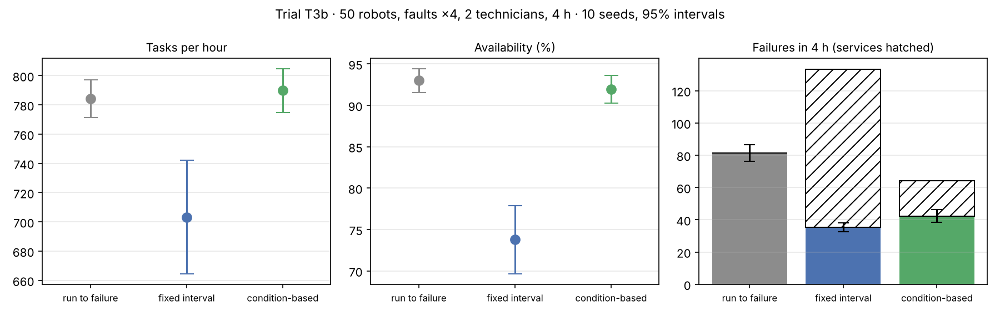

# T3b · Maintenance policy without the charging confound

**Status:** pre-registered on 2026-11-09, before any T3b run **and before T3's results were looked at** (T3 was still running). Results are appended below the line; the protocol is not edited afterwards.

**Disclosure.** [T2](T2-repair-capacity.md) showed that with batteries on and 4 chargers the fleet's throughput is limited by charging, which can hide the effect of faults and repairs. T3 uses the same battery setup, so T3b repeats it with batteries off. No T3 result had been seen when this was written.

## Hypotheses

Same as [T3](T3-maintenance.md):

- **H1.** Condition-based maintenance completes more tasks per hour than run-to-failure (paired ratio, lower 95% bound > 1).
- **H2.** Condition-based maintenance completes more tasks per hour than fixed-interval maintenance (paired ratio, lower 95% bound > 1).
- **H3.** Condition-based maintenance has at least 30% fewer failures than run-to-failure (mean paired reduction ≥ 0.3).

## Protocol

Identical to T3 except **batteries off**: 50 robots, load 1.0, nearest-pair dispatch, faults ×4, 2 technicians, aged fleet (initial wear U(0, 0.6)); policies none / interval (5,400 s) / condition (wear ≥ 0.5); 600 s warm-up then 4 h measured; 10 seeds with common random numbers.

Reproduce:

```bash
fleetsim bench --robots 50 --loads 1.0 --allocators nearest --initial-wear 0.6 --faults 4 --techs 2 --maintenance none interval condition --ticks 14400 --replications 10 --no-db --no-parquet --out results/T3b
```

---

## Results (run 2026-11-09, commit `c25c5d0`)

30 runs of 4 simulated hours, **0 collisions**. Raw data: [`results/T3b/runs.csv`](../../results/T3b/runs.csv). Tables and chart: `python scripts/analyze_t2_t3.py T3b`.



Orders offered: 782 per hour. Mean ± 95% half-width over 10 seeds:

| Policy | Tasks/h | Availability | Failures in 4 h | Services in 4 h | MTTR (s) | Mean order wait (s) | p95 order wait (s) |
|---|---:|---:|---:|---:|---:|---:|---:|
| Run to failure | 784.2 ± 13.0 | 0.930 ± 0.014 | 81.4 ± 5.0 | 0 | 616 ± 94 | 19 | 87 ± 46 |
| Fixed interval (5,400 s) | 703.2 ± 38.9 | 0.738 ± 0.041 | 35.2 ± 2.7 | 98.1 ± 4.7 | 1,486 ± 254 | 1,002 | 1,764 ± 687 |
| Condition-based (wear ≥ 0.5) | 789.8 ± 15.0 | 0.919 ± 0.016 | 42.3 ± 4.0 | 21.8 ± 3.0 | 684 ± 146 | 118 | 381 ± 163 |

Paired by seed: condition / run-to-failure = **1.007 [1.004, 1.010]**; condition / interval = **1.130 [1.055, 1.205]**; interval / run-to-failure = 0.898 [0.843, 0.952]. Failure reduction against run-to-failure: condition **48.2% [45.8%, 50.5%]**, interval 56.6% [53.1%, 60.1%].

### Verdicts against the pre-registered bars

- **H1: holds by the bar, but the effect is negligible.** Condition-based completes 0.7% more tasks than run-to-failure (lower bound +0.4%). Both policies complete essentially every order offered (782/h), so throughput cannot separate them here.
- **H2: holds.** Condition-based completes 13% more than the fixed interval (lower bound +5.5%).
- **H3: holds clearly.** 48% fewer failures than run-to-failure.

### The result that argues against condition-based maintenance

On the metric the bars did not include, **order wait**, run-to-failure is better: 19 s mean (87 s at p95) against 118 s (381 s at p95) for condition-based. Services and repairs share the same two technicians, so the 22 services lengthen the repair queue (a robot waits 442 s for a technician instead of 347 s), and robots are out of service slightly more of the time (availability 91.9% vs 93.0%).

So in a fleet with spare capacity, condition-based maintenance halves failures but **does not pay for itself in throughput and costs waiting time**. T3's +5.5% came from the charging regime, where a robot taken home for service was about to sit idle anyway.

The fixed interval is again the worst by far (−10% tasks/h, availability 74%): 98 services in 4 hours swamp two technicians.

### What this changes

1. The claim that survives both T3 and T3b: condition-based maintenance cuts failures by a third to a half and always beats a fixed 90-minute interval. The claim that does not survive: that it raises throughput. That depends on the regime.
2. Whether halving failures is worth longer waits depends on costs this model does not price: damage, safety, technician walks onto the floor, stranded orders. A cost model is the missing piece.
3. Follow-ups: sweep the wear threshold and the interval; give services their own crew; run at a load where fleet capacity binds; add technician corridors to see what each walk onto the floor costs.
