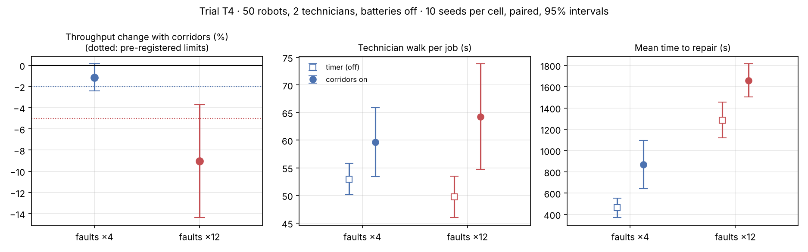

# T4 · What do protected technician corridors cost?

**Status:** pre-registered on 2026-11-09, before any T4 run. Results are appended below the line; the protocol is not edited afterwards.

**Disclosure.** Three smoke runs with corridors on were seen while building the feature: 50 robots, faults ×12, 2 technicians, seed 0 → 607 tasks/h; 50 robots, faults ×4, 2 technicians, seed 1 → 843 tasks/h, with a mean technician walk of 67 s against 51 s without corridors for the same seed; 80 robots, faults ×12, 3 technicians, seed 2 → 722 tasks/h. All three had zero conflicts. The no-corridor arm of this trial repeats two cells of [T2b](T2b-repair-capacity-no-battery.md) (790.7 and 636.4 tasks/h on average), so the hypotheses below are informed predictions.

## Background

Until now a technician was a timer: the walk to a broken robot took its shortest-path time and nobody was physically on the floor. With `tech_corridors=True` a technician is a priority agent in the reservation table. The whole duty is booked at once (walk out, stand next to the robot, repair, walk back to a base robots may not enter). Robots whose routes cross the corridor replan or stop. No robot may ever share a cell with a technician.

That safety has a price: robots detour or wait, technicians walk around obstacles instead of through them, and a technician with no job walks home, so the next walk can start from further away. This trial measures the price.

## Hypotheses

- **H1 (safety).** In every corridor run: zero robot–robot conflicts, zero robot–technician conflicts (same cell, or swapping cells), no technician ever jumps to a non-adjacent cell, and no robot ever stands on a technician base.
- **H2.** At normal faults (×4), corridors cost less than 2% of throughput: the paired ratio corridors-on / corridors-off has a lower 95% bound above 0.98.
- **H3.** At frequent faults (×12), corridors cost less than 5%: lower 95% bound above 0.95.
- **H4.** Technicians walk longer per job with corridors on (mean paired difference in walk time above 0, lower 95% bound above 0).

## Protocol

| Factor | Levels |
|---|---|
| Technician model | timer (corridors off), priority corridors (on) |
| Fault rate | 4 (normal), 12 (frequent) |
| Fixed | 50 robots, load 1.0, nearest-pair dispatch, 2 technicians, batteries off, aged fleet (initial wear U(0, 0.6)), run-to-failure maintenance |
| Replications | 10 seeds (0–9), common random numbers: the same orders, robot homes, initial wear and per-tick fault draws in both arms |

Each run: 600 s warm-up, then 3,600 s measured. Metrics: tasks/h, order wait, MTTR split into queue, walk and repair, corridor reroutes, blocked share, and the four safety counts of H1. Arms are compared by seed with 95% t-intervals. The off arm should reproduce T2b's two cells exactly; if it does not, that is reported as a defect.

Two differences between the arms are part of the treatment and not controlled away: the technician repairs from a neighbouring cell instead of the robot's own cell, and technician base cells are closed to robots.

Reproduce:

```bash
fleetsim bench --robots 50 --loads 1.0 --allocators nearest --initial-wear 0.6 --faults 4 12 --techs 2 --corridors off on --replications 10 --no-db --no-parquet --out results/T4
```

---

## Results (run 2026-11-09, commit `664eed3`)

40 runs, **0 robot–robot collisions, 0 robot–technician conflicts**. Raw data: [`results/T4/runs.csv`](../../results/T4/runs.csv). Tables and chart: `python scripts/analyze_t4.py`.



The corridors-off arm reproduces T2b's two cells exactly, as it should. Means over 10 seeds:

| Faults | Corridors | Tasks/h | Mean order wait (s) | Availability | MTTR (s) | of which queue (s) | Technician walk (s) | Robot reroutes per run |
|---:|---|---:|---:|---:|---:|---:|---:|---:|
| ×4 | off | 790.7 | 12 | 0.948 | 462 | 144 | 53 | 0 |
| ×4 | on | 781.7 | 28 | 0.904 | 867 | 546 | 60 | 110 |
| ×12 | off | 636.4 | 242 | 0.697 | 1,287 | 978 | 50 | 0 |
| ×12 | on | 577.2 | 360 | 0.644 | 1,658 | 1,338 | 64 | 97 |

Paired by seed, corridors on / off: tasks/h **0.989 [0.976, 1.001]** at faults ×4 and **0.910 [0.856, 0.963]** at faults ×12. Technician walk per job: +6.7 s [+0.4, +12.9] and +14.6 s [+4.8, +24.3].

### Verdicts against the pre-registered bars

- **H1 (safety): holds.** No robot ever shared a cell or swapped cells with a technician, no technician jumped cells, no robot stood on a technician base, and there were no robot–robot collisions.
- **H2: fails, narrowly.** At normal faults the mean cost is 1.1%, but the interval's lower bound is 0.976, below the 0.98 bar.
- **H3: fails.** At frequent faults corridors cost 9.0% of throughput (lower bound 0.856; the bar was 0.95).
- **H4: holds.** Technicians walk 7–15 s longer per job.

### Why the cost is so high (exploratory, not pre-registered)

The extra repair time is almost all **queueing** (+400 s per job), not walking (+7 to +15 s). Tracing one run showed why: one of the two technician bases, (0, 6), was walled in. Robots park at homes on three sides of it, and the only gap left was regularly inside the other technician's booked corridor, which this implementation treats as a wall for the whole duty. That technician failed to find a route **335 times** in a single run and sat idle while jobs waited. With the crew already near its limit (about 1.8 technician-hours of work per hour for 2 technicians), losing part of one technician blows up the queue.

`choose_tech_bases` promised that "every base keeps a way out" but only checked for one free neighbouring cell. That is a defect in the feature, so these throughput numbers measure a corridor system with a badly placed base, not corridors as such.

### What this changes

1. The safety result stands: booked priority corridors keep people and robots apart in all 20 corridor runs.
2. The cost numbers do not stand as a measure of corridors. [T4b](T4b-technician-corridors-fixed-bases.md) repeats the trial after fixing base placement, pre-registered with these results disclosed.
3. A design lesson either way: where technicians start from matters as much as the corridors, and near a crew's capacity limit small losses turn into long queues.
