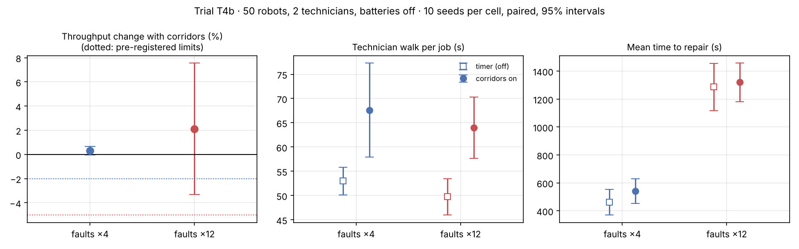

# T4b · Corridor cost with correctly placed technician bases

**Status:** pre-registered on 2026-11-09, before any T4b run. Results are appended below the line; the protocol is not edited afterwards.

**Disclosure.** This follow-up was designed after seeing [T4](T4-technician-corridors.md): corridors cost 1.1% of throughput at faults ×4 (interval down to 2.4%) and 9.0% at faults ×12, and the cause was traced to a technician base walled in by parked robots. The base-placement defect was fixed in the commit before this file. No corridor run with the new placement has been looked at for throughput; the unit tests ran such simulations and passed their safety checks.

## Hypotheses

Same bars as T4, so the two trials can be compared directly:

- **H1 (safety).** In every corridor run: zero robot–robot conflicts, zero robot–technician conflicts, no technician jumps cells, no robot stands on a technician base.
- **H2.** At normal faults (×4), corridors cost less than 2% of throughput: paired ratio on / off with a lower 95% bound above 0.98.
- **H3.** At frequent faults (×12), corridors cost less than 5%: lower 95% bound above 0.95.
- **H4.** Technicians walk longer per job with corridors on (lower 95% bound of the paired difference above 0).
- **H5 (the fix worked).** Corridor arms complete more tasks per hour than T4's corridor arms did with the same seeds (paired ratio T4b / T4, lower 95% bound above 1) at both fault rates.

My honest expectation: H2 holds; H3 is uncertain, because a crew working near its limit turns any lost technician time into long queues.

## Protocol

Identical to T4: 50 robots, load 1.0, nearest-pair dispatch, 2 technicians, batteries off, aged fleet, run-to-failure; corridors off / on × faults ×4 / ×12; 10 seeds with common random numbers; 600 s warm-up and 3,600 s measured. Only the technician base cells differ from T4, and only in the corridor arm.

Reproduce:

```bash
fleetsim bench --robots 50 --loads 1.0 --allocators nearest --initial-wear 0.6 --faults 4 12 --techs 2 --corridors off on --replications 10 --no-db --no-parquet --out results/T4b
```

---

## Results (run 2026-11-09, commit `205691f`)

40 runs, **0 robot–robot collisions, 0 robot–technician conflicts**. Raw data: [`results/T4b/runs.csv`](../../results/T4b/runs.csv). Tables and chart: `python scripts/analyze_t4.py T4b`.



**How it was run.** The first launch was stopped by a 30-minute limit on background jobs while one run was still going (see "One run deadlocked" below); it had written nothing. The data here come from a second launch of the same command on a clean checkout of commit `205691f`. The two runs I compared between the two launches (faults ×12, corridors on, seeds 0 and 1) show the same tasks per hour and order wait, as a deterministic simulator should.

The corridors-off arm again reproduces T2b's two cells exactly. Means over 10 seeds:

| Faults | Corridors | Tasks/h | Mean order wait (s) | Availability | MTTR (s) | of which queue (s) | Technician walk (s) | Robot reroutes per run |
|---:|---|---:|---:|---:|---:|---:|---:|---:|
| ×4 | off | 790.7 | 12 | 0.948 | 462 | 144 | 53 | 0 |
| ×4 | on | 793.1 | 14 | 0.940 | 541 | 203 | 68 | 40 |
| ×12 | off | 636.4 | 242 | 0.697 | 1,287 | 978 | 50 | 0 |
| ×12 | on | 648.9 | 230 | 0.697 | 1,320 | 997 | 64 | 42 |

Paired by seed, corridors on / off: tasks/h **1.003 [1.000, 1.006]** at faults ×4 and **1.021 [0.967, 1.076]** at faults ×12. Technician walk per job: +15 s [+6, +23] and +14 s [+8, +21]. Corridor arms against T4's, same seeds: **1.015 [0.999, 1.031]** at ×4 and **1.125 [1.075, 1.176]** at ×12.

### Verdicts against the pre-registered bars

- **H1 (safety): holds.** Zero conflicts of any kind in all 20 corridor runs; no robot on a technician base.
- **H2: holds.** At normal faults the lower bound is 1.000, above 0.98. Corridors cost nothing measurable.
- **H3: holds.** At frequent faults the lower bound is 0.967, above 0.95. The interval is wide (±5.5%) and includes zero cost and a 3% cost.
- **H4: holds.** Technicians walk about 15 s longer per job at both fault rates.
- **H5: fails as stated.** It required a gain over T4 at both fault rates. At ×12 the gain is clear (+12.5%, lower bound 1.075). At ×4 the mean gain is 1.5% but the lower bound is 0.999, just under 1.

The point estimates above 1 are not a finding: nothing here shows corridors *raise* throughput.

### One run deadlocked (exploratory, not pre-registered)

Faults ×12, corridors on, seed 2 took 2,493 s of computing instead of about 10 s, and finished 8% below its corridors-off twin (556 against 604 tasks/h). Replaying it:

- At second 2,785 a robot stood failed on cell (5, 3), the only open approach to the base of technician 1 at (4, 2). The other approach runs through the other technician's base, which is always treated as blocked.
- Technician 1 had just finished a job at (45, 65). It could walk to all 20 robots then waiting for repair, but the booking rule demands a way back to base **at booking time**, with the broken robot still in place. No job passed, including the one that would have reopened the base: the robot on (5, 3) itself.
- That job was last in a first-come queue of 20, so the other technician would not have reached it within the run. Technician 1 stood in an aisle from second 2,785 until at least second 2,829, where the replay was stopped; the full run was not replayed to its end.
- Robots waiting behind it retried their routes every 3 s. Each retry is a search that runs to its limit of 200,000 steps, which is where the computing time went.

So T4b's cost figures include one run in which half the crew stopped working for part of the hour. The verdicts above are unchanged by that; it does widen the ×12 interval.

### What this changes

1. Fixing base placement removed the cost T4 measured: with correctly placed bases, corridors cost under 2% at normal faults and under 5% at frequent faults by the pre-registered bars.
2. Safety has now held in 40 corridor runs across T4 and T4b.
3. A new defect is on record: a technician cut off from base stops taking jobs. The fix (accept a job without a way home, repair first the robot that blocks the base) needs its own pre-registered rerun, T4c, before any claim that corridors are free of deadlocks.
4. A performance defect is on record too: a route search that cannot succeed runs to its expansion limit on every retry.

