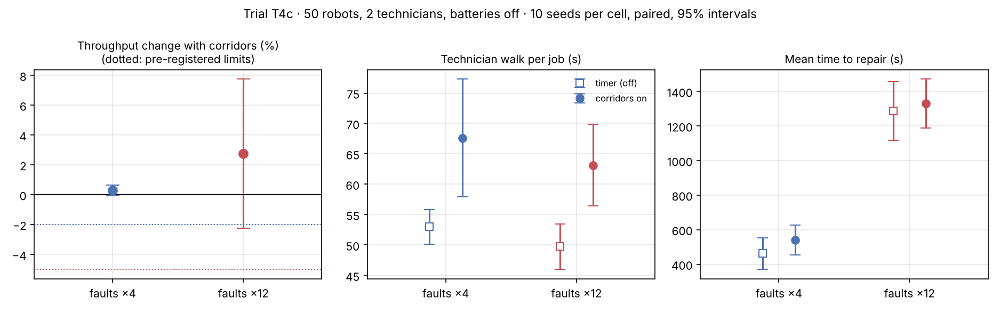

# T4c · Technician corridors after the deadlock fix

**Status:** pre-registered on 2026-11-09, before any T4c run. Results are appended below the line; the protocol is not edited afterwards.

**Disclosure.** This follow-up was designed after seeing [T4b](T4b-technician-corridors-fixed-bases.md), where one run deadlocked: a failed robot closed the only approach to a technician's base, and the technician, who had to book a way home with every job, stopped taking jobs. Two changes were made in the commit before this file:

1. A technician with no way home still takes the job and looks for the way home after the repair.
2. The cheap reachability check that runs before a route search now counts technician bases as closed to robots. This changes computing time only; with change 1 switched off, three T4b corridor runs were reproduced exactly.

Seen before registering, with both changes: the unit tests, and a replay of the deadlocked run (faults ×12, seed 2) up to second 3,000, in which the longest time a technician stood idle with a job waiting was 1 s and computing took 5 s instead of 88 s. No throughput figure from any run with change 1 has been looked at.

## Hypotheses

- **H1 (safety).** In every corridor run: zero robot–robot conflicts, zero robot–technician conflicts, no technician jumps cells, no robot stands on a technician base.
- **H2.** At normal faults (×4), corridors cost less than 2% of throughput: paired ratio on / off with a lower 95% bound above 0.98.
- **H3.** At frequent faults (×12), corridors cost less than 5%: lower 95% bound above 0.95.
- **H4 (the deadlock is gone).** In every corridor run, no technician is idle for 120 consecutive seconds or more while a repair job is waiting (`tech_idle_with_work_max_s` below 120).
- **H5 (the fix does no harm).** Corridor arms against T4b's corridor arms with the same seeds: paired ratio T4c / T4b with a lower 95% bound above 0.98 at both fault rates.

Also reported, without a bar: how many corridor runs differ from T4b at all, and computing time per run.

My honest expectation: H1, H2 and H4 hold. H3 held in T4b with a wide interval and could go either way. H5 should hold at ×4, where the no-way-home case is rare; at ×12 I do not know, because a technician who keeps working far from base changes which robot is repaired next.

## Protocol

Identical to T4 and T4b: 50 robots, load 1.0, nearest-pair dispatch, 2 technicians, batteries off, aged fleet, run-to-failure; corridors off / on × faults ×4 / ×12; 10 seeds with common random numbers; 600 s warm-up and 3,600 s measured.

Reproduce:

```bash
fleetsim bench --robots 50 --loads 1.0 --allocators nearest --initial-wear 0.6 --faults 4 12 --techs 2 --corridors off on --replications 10 --no-db --no-parquet --out results/T4c
```

---

## Results (run 2026-11-09, commit `99b7e70`)

40 runs, **0 robot–robot collisions, 0 robot–technician conflicts**. Raw data: [`results/T4c/runs.csv`](../../results/T4c/runs.csv). Tables and chart: `python scripts/analyze_t4.py T4c`.



The corridors-off arm reproduces T2b's two cells exactly. Means over 10 seeds:

| Faults | Corridors | Tasks/h | Mean order wait (s) | Availability | MTTR (s) | of which queue (s) | Technician walk (s) | Robot reroutes per run |
|---:|---|---:|---:|---:|---:|---:|---:|---:|
| ×4 | off | 790.7 | 12 | 0.948 | 462 | 144 | 53 | 0 |
| ×4 | on | 793.1 | 14 | 0.940 | 541 | 203 | 68 | 40 |
| ×12 | off | 636.4 | 242 | 0.697 | 1,287 | 978 | 50 | 0 |
| ×12 | on | 652.8 | 228 | 0.700 | 1,331 | 1,008 | 63 | 43 |

Paired by seed, corridors on / off: tasks/h **1.003 [1.000, 1.006]** at faults ×4 and **1.027 [0.978, 1.077]** at faults ×12. Corridor arms against T4b's, same seeds: **1.000 [1.000, 1.000]** at ×4 and **1.007 [0.996, 1.017]** at ×12.

Longest time a technician stood idle while a repair job waited, per corridor run (seeds 0–9):

| Faults | Seconds |
|---|---|
| ×4 | 132, 0, 1, 186, 141, 1, 1, 1, 1, 1 |
| ×12 | 176, 0, 1, 28, 0, 274, 1, 1, 0, 1 |

### Verdicts against the pre-registered bars

- **H1 (safety): holds.** Zero conflicts of any kind in all 20 corridor runs; no robot on a technician base.
- **H2: holds.** Lower bound 1.000, above 0.98.
- **H3: holds.** Lower bound 0.978, above 0.95.
- **H4: fails.** In 5 of 20 corridor runs a technician was idle for 120 s or more with a job waiting (up to 274 s). On average this is 1.0% of technician time at ×4 and 0.7% at ×12; the worst run reaches 4.8%.
- **H5: holds.** The fix did no harm: all 10 corridor runs at ×4 and 8 of 10 at ×12 are identical to T4b, and the other two gained (seed 2: 556 to 581 tasks/h, seed 9: 662 to 676 tasks/h).

Not pre-registered: the run that deadlocked in T4b (faults ×12, seed 2) now completes 581 tasks/h instead of 556 and computes in 11 s instead of 2,493 s. The slowest run of the 40 took 18 s.

### Why technicians still stand idle (exploratory, not pre-registered)

The deadlock T4b found is gone, but H4 measured something T4b could not see. Because all ten ×4 runs are identical to T4b, these idle spells were already there. Tracing two of them (×4 seed 0 and ×12 seed 5) shows two separate causes:

1. **A colleague's corridor is a wall for its whole duty.** While technician 0 repaired a robot near the left wall, its booked walk back to base ran past the only approach to technician 1's base. The model treats another technician's remaining route as blocked from now until the duty ends, not only at the seconds the technician is actually there. Technician 1 could not leave base for the length of a repair.
2. **The job queue starves reachable jobs.** A free technician tries one waiting job per second, oldest first, and an unreachable job is retried after 5 s. So the five oldest unreachable jobs cycle forever and later jobs are never tried. In the ×12 trace three robots could have been reached and were not.

### What this changes

1. Across T4b and T4c, with correctly placed bases, corridors cost under 2% of throughput at normal faults and under 5% at frequent faults by the pre-registered bars. Zero robot–technician conflicts in 60 corridor runs across T4, T4b and T4c.
2. The claim "technicians are never kept from work that is waiting" is **not** supported. Two defects are on record: technicians block each other for whole duties, and the queue starves reachable jobs.
3. Next rerun (T4d) needs both fixed: try every waiting job until one can be reached, and treat another technician's route as occupied only when and where the technician is there. Bases should also not share a single approach.

